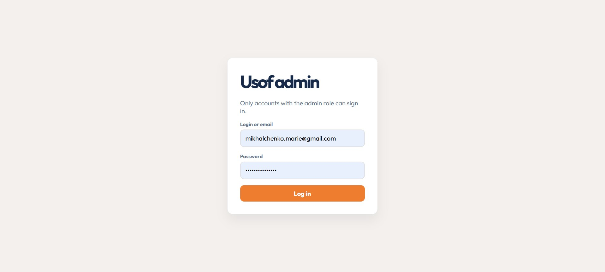
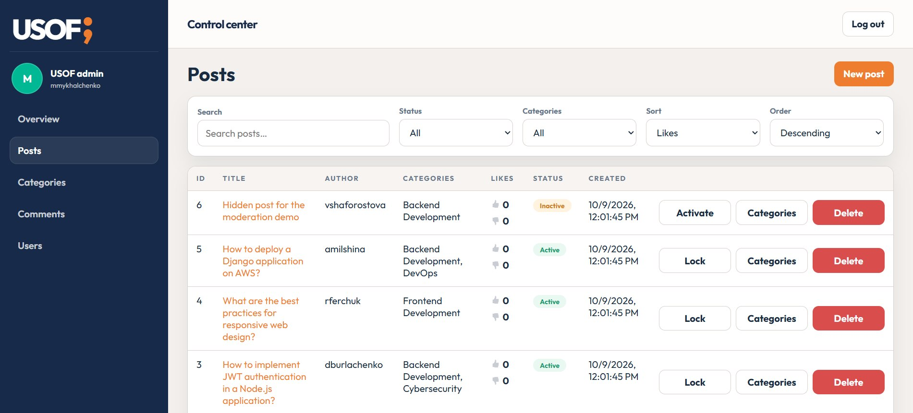
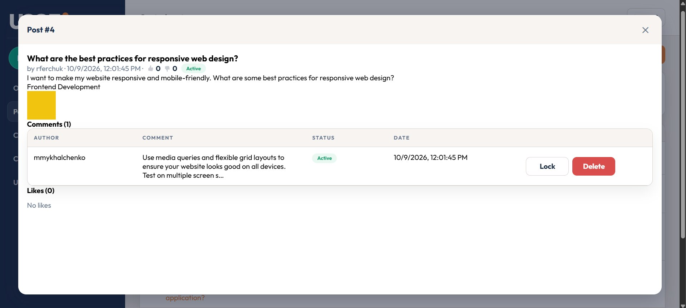
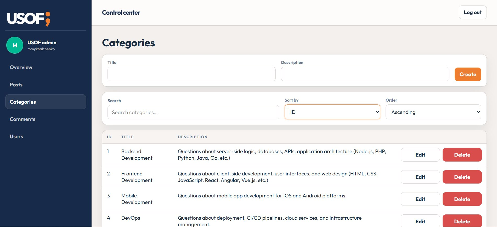
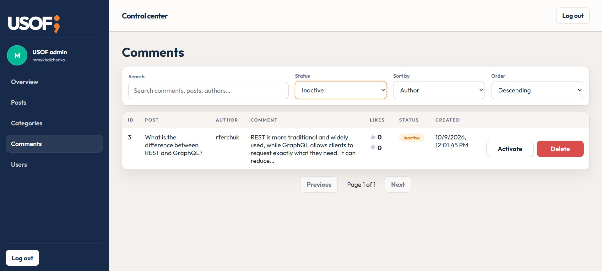
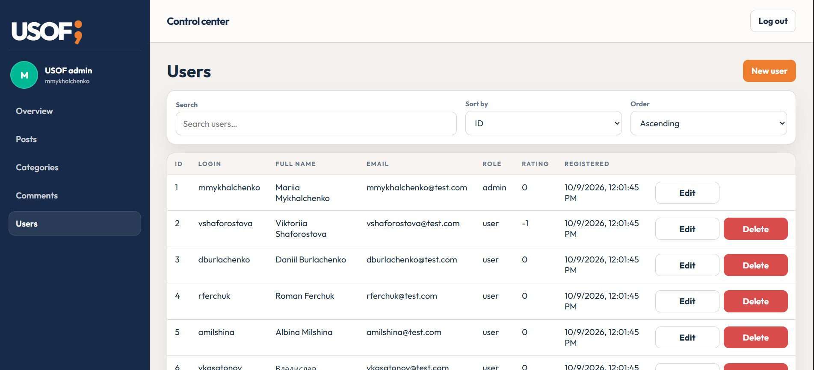
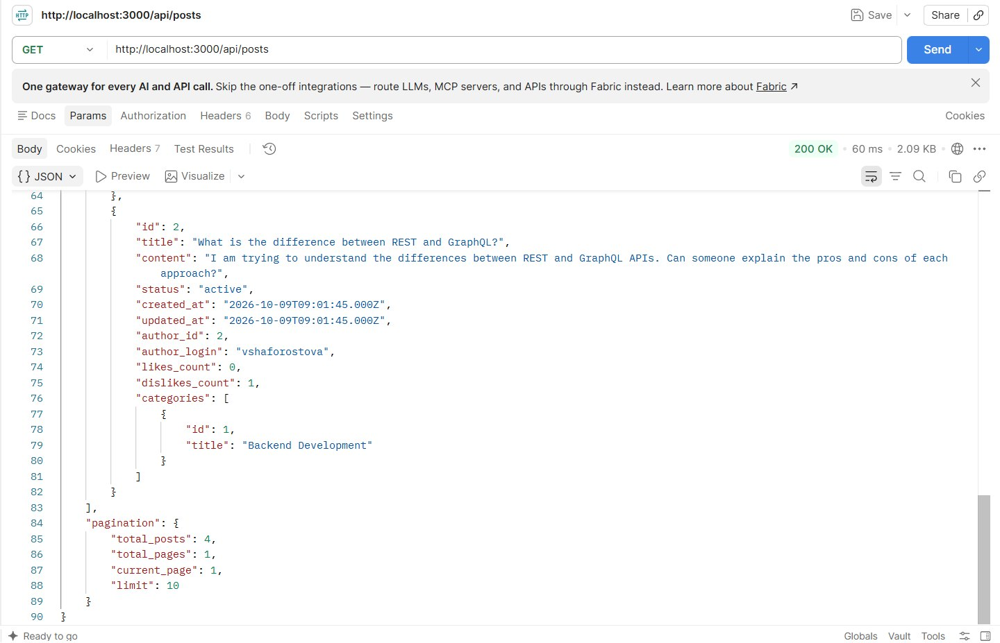

# Usof Backend

Usof is a REST API and web administration panel for a question-and-answer service for professional and enthusiast programmers. Users can publish posts, organize them into categories, discuss them in comments, and vote on posts and comments. Votes contribute to each author's rating. Administrators moderate content and manage users and categories.

This repository implements the backend foundation for a future client application. It was developed for the **Full Stack Track** backend challenge.

## Contents

- [Features](#features)
- [Screenshots](#screenshots)
- [Technology and requirements](#technology-and-requirements)
- [Getting started](#getting-started)
- [Configuration](#configuration)
- [Database and sample data](#database-and-sample-data)
- [Available scripts](#available-scripts)
- [API overview](#api-overview)
- [Access control](#access-control)
- [Architecture and application flow](#architecture-and-application-flow)
- [Key algorithms](#key-algorithms)
- [Challenge progress](#challenge-progress)

## Features

- Registration, email confirmation, login, logout, and password reset
- `user` and `admin` roles with authorization enforced by the API
- Admin panel at `/admin` for managing posts, categories, comments, and users
- Post attachments stored on the server's local file system
- Pagination, sorting, and filtering for post lists
- Comments, likes, and dislikes on posts and comments
- Automatic author ratings based on likes and dislikes
- Favorites and subscriptions to posts and categories
- Notifications for followed-post activity, followed-category posts, and category deletion
- Suggested replacement categories when a category is deleted
- MySQL database and sample data initialized by the application

## Screenshots

Screenshots are stored in [`docs/screenshots/`](docs/screenshots/) and show the current admin panel. Refresh them after interface changes, keeping the same filenames:

1. `admin-login.jpg` — the admin sign-in page.
2. `admin-posts.jpg` — the posts list with search, filters, sorting, and aligned moderation actions.
3. `admin-post-details.jpg` — the full post-details dialog, with an attachment and its comments/likes visible.
4. `admin-categories.jpg` — category management showing the search, sort controls, and grid/table layout.
5. `admin-comments.jpg` — comment moderation showing search, status filter, sorting, and action buttons.
6. `admin-users.jpg` — user management showing search, sorting, and aligned actions.
7. `api-posts.jpg` — a successful `GET /api/posts` response in Postman or another HTTP client.

Capture the admin pages at the same browser size and zoom so they look consistent. Use seeded or otherwise fictional data, and ensure screenshots do not expose real credentials, tokens, or personal information.















## Technology and requirements

- Node.js **22.2 or newer**
- MySQL **8.0 or newer**
- npm, included with Node.js
- SMTP credentials for sending email confirmation and password-reset messages (Mailtrap is suitable for development)
- An HTTP client such as Postman or `curl` to explore the API

The application uses Express, `mysql2`, `bcrypt`, `jsonwebtoken`, `multer`, `nodemailer`, `node-cron`, and `dotenv`. ESLint and Prettier are used for development checks and formatting. Dependencies are installed through `npm install`.

## Getting started

1. Clone the repository and enter the project directory:

    ```sh
    git clone https://github.com/mihasbea/Usof.git
    cd Usof
    ```

2. Install dependencies:

    ```sh
    npm install
    ```

3. The `.env` file is not included in the repository. Create a `.env` file in the project directory, copy the contents of `.env.example` into it, and update the values for your environment. See [Configuration](#configuration).

4. Ensure MySQL is running and that the configured MySQL account can create and use the database. Start the application:

    ```sh
    npm start
    ```

    On startup, the application creates the configured database if necessary, applies the schema, and seeds it when the `users` table is empty. The API defaults to `http://localhost:3000`; set `PORT` to use another port.

5. Open `http://localhost:3000/admin` to use the administration panel, or send requests to the API at `http://localhost:3000/api`.

### Configuration

| Variable                         | Purpose                                                                  |
| -------------------------------- | ------------------------------------------------------------------------ |
| `PORT`                           | HTTP server port; defaults to `3000`                                     |
| `APP_URL`                        | Public base URL used to construct API email links                        |
| `CLIENT_URL`                     | Frontend base URL used in password-reset links                           |
| `DB_HOST`                        | MySQL server hostname                                                    |
| `DB_USER`                        | MySQL username                                                           |
| `DB_PASSWORD`                    | MySQL password                                                           |
| `DB_NAME`                        | Database name to create and use                                          |
| `JWT_SECRET`                     | Secret used to sign access tokens; use a long, random value              |
| `MAILTRAP_HOST`, `MAILTRAP_PORT` | Mailtrap SMTP host and port; defaults to `sandbox.smtp.mailtrap.io:2525` |
| `MAILTRAP_USER`, `MAILTRAP_PASS` | Credentials for the Mailtrap test inbox                                  |

The server requires `DB_HOST`, `DB_USER`, `DB_NAME`, and `JWT_SECRET`. Mailtrap credentials are required to send confirmation and password-reset messages. Never commit `.env` or share its credentials.

### Setting up Mailtrap and testing email

The application uses Mailtrap's **Email Testing** inbox as its only email transport. This is intentional for a student project: messages can be inspected without delivering test emails to real recipients. The email templates are the same for confirmation and password reset.

#### 1. Create a Mailtrap test inbox

1. Sign in to [Mailtrap](https://mailtrap.io/).
2. Open **Email Testing** and create or select an inbox for this project.
3. Open the inbox's **SMTP Settings** and select **Nodemailer** (or view the SMTP credentials if that preset is not available).
4. Copy the inbox's host, port, username, and password. These are inbox-specific SMTP credentials, not your Mailtrap account password.

#### 2. Add the inbox credentials to the project

1. In the project root, create `.env` by copying `.env.example` if it does not already exist.
2. Paste the copied values into these entries in `.env`:

    ```env
    MAILTRAP_HOST=sandbox.smtp.mailtrap.io
    MAILTRAP_PORT=2525
    MAILTRAP_USER=paste_the_inbox_username_here
    MAILTRAP_PASS=paste_the_inbox_password_here
    ```

    Use the exact host and port shown for your inbox if they differ. Do not add quotes around the username or password unless Mailtrap explicitly includes them.

3. Keep `APP_URL=http://localhost:3000` for a local API. `CLIENT_URL` is used to build password-reset links; the user-facing reset page is not included in this repository.
4. Save `.env` and restart the server with `npm start`. The `.env` file is ignored by Git; do not commit it or include its credentials in screenshots.

#### 3. Test email confirmation

1. Open Postman and create a `POST` request to `http://localhost:3000/api/auth/register`.
2. Select **Body → raw → JSON** and use a unique login and email:

```json
{
    "login": "mailtestuser",
    "password": "TestPassword123",
    "password_confirmation": "TestPassword123",
    "full_name": "Mail Test User",
    "email": "mailtestuser@example.com"
}
```

3. Click **Send**. A successful registration returns HTTP `201`. If sending fails, the API returns HTTP `502` and removes the unconfirmed account so the request can be retried.
4. In Mailtrap, open the inbox and find the newest message with subject **Confirm your Usof email address**. The recipient address can be fictional: Mailtrap captures the message instead of delivering it to a real mailbox.
5. Open the message and inspect its branded HTML version. Click **Confirm email address**. Since `APP_URL` points to localhost, open the link on the computer running the API. The API should respond that the email has been confirmed.

#### 4. Test password-reset email

1. Send `POST http://localhost:3000/api/auth/password-reset` with a registered email in the JSON body, for example:

    ```json
    {
        "email": "mailtestuser@example.com"
    }
    ```

2. The API intentionally returns the same generic response whether or not the address exists. Check the Mailtrap inbox for a new message with subject **Reset your Usof password**.
3. The reset link points to `CLIENT_URL`, which is the frontend URL. This repository does not include the frontend reset form. To test the backend reset endpoint, copy the token from the link and send `POST http://localhost:3000/api/auth/password-reset/<token>` with:

    ```json
    {
        "new_password": "AnotherTestPassword123",
        "new_password_confirmation": "AnotherTestPassword123"
    }
    ```

    Replace `<token>` with the token from the email. Reset tokens expire after one hour and can only be used once.

#### Troubleshooting

- If registration returns HTTP `502`, check the server terminal and confirm that the inbox's SMTP host, port, username, and password were copied correctly into `.env`.
- After every `.env` change, stop and restart the server; already-running processes do not automatically reload environment variables.
- Check that you are viewing the correct Mailtrap inbox and its newest message.
- If Postman reports that the login or email is already in use, change both to new unique test values.
- Mailtrap captures test messages; it does not deliver them to the address in the request.

### Database and sample data

The schema is in [`db/schema.sql`](db/schema.sql), and the sample records are in [`db/seed.sql`](db/seed.sql). The initializer creates the tables and inserts sample data when the database has no users. The sample dataset is designed to provide at least five records in each table.

The seeded accounts are for local development only. They share the password `Password123`; do not use these credentials outside a local, disposable environment.

| Login           | Role    |
| --------------- | ------- |
| `mmykhalchenko` | `admin` |
| `vshaforostova` | `user`  |
| `dburlachenko`  | `user`  |
| `rferchuk`      | `user`  |
| `amilshina`     | `user`  |
| `vkasatonov`    | `user`  |

To recreate the database and regenerate sample data:

```sh
npm run reset-db
```

**Warning:** this command drops the configured database and removes the application's uploaded files before recreating them. Back up any data you need before running it.

### Available scripts

| Command                | Description                                            |
| ---------------------- | ------------------------------------------------------ |
| `npm start`            | Initialize the database if needed and start the server |
| `npm run dev`          | Start the server with Node.js watch mode               |
| `npm run init-db`      | Create the schema and seed an empty database           |
| `npm run reset-db`     | Drop and recreate the database, then seed it           |
| `npm run lint`         | Run ESLint                                             |
| `npm run format`       | Format supported files with Prettier                   |
| `npm run format:check` | Check formatting without modifying files               |

## API overview

All API routes are prefixed with `/api`. Protected routes require a bearer token returned by `POST /api/auth/login`:

```http
Authorization: Bearer <token>
```

Access tokens expire after three hours. Logout revokes the current token. Error responses use a JSON object with a `message` field.

| Resource       | Base path            | Main operations                                                                                                      |
| -------------- | -------------------- | -------------------------------------------------------------------------------------------------------------------- |
| Authentication | `/api/auth`          | Register, log in/out, confirm email, request and complete password reset                                             |
| Users          | `/api/users`         | Read profiles; admins create users; profile owners and admins update or delete users                                 |
| Posts          | `/api/posts`         | List, create, read, update, and delete posts; manage their comments, categories, votes, favorites, and subscriptions |
| Categories     | `/api/categories`    | Read categories and their posts; admins create, update, and delete categories                                        |
| Comments       | `/api/comments`      | Admin comment listing; read, moderate, delete, and vote on comments                                                  |
| Favorites      | `/api/favorites`     | List the authenticated user's saved posts                                                                            |
| Subscriptions  | `/api/subscriptions` | List followed posts and categories                                                                                   |
| Notifications  | `/api/notifications` | List, read, and delete the authenticated user's notifications                                                        |

### Authentication endpoints

| Method | Path                                      | Purpose                                 |
| ------ | ----------------------------------------- | --------------------------------------- |
| `POST` | `/api/auth/register`                      | Register a user                         |
| `POST` | `/api/auth/login`                         | Log in with login or email and password |
| `POST` | `/api/auth/logout`                        | Revoke the current token                |
| `GET`  | `/api/auth/confirm-email/:token`          | Confirm an email address                |
| `POST` | `/api/auth/password-reset`                | Request a password-reset email          |
| `POST` | `/api/auth/password-reset/:confirm_token` | Set a new password using a reset token  |

### Post lists

`GET /api/posts`, `GET /api/categories/:category_id/posts`, `GET /api/favorites`, and `GET /api/subscriptions/posts` support these query parameters:

| Parameter              | Values                                                                        | Default            |
| ---------------------- | ----------------------------------------------------------------------------- | ------------------ |
| `page`                 | Positive integer                                                              | `1`                |
| `limit`                | Integer from `1` to `100`                                                     | `10`               |
| `sort`                 | `likes`, `date`                                                               | `likes`            |
| `order`                | `asc`, `desc`                                                                 | `desc`             |
| `status`               | `active`, `inactive`                                                          | No status filter   |
| `categories`           | Comma-separated category IDs, for example `1,3`                               | No category filter |
| `date_from`, `date_to` | Dates in `YYYY-MM-DD` format; boundaries are inclusive                        | No date filter     |
| `search`               | Up to 255 characters; matches post title, content, author login, or full name | No search          |

Post-list responses include `data` and pagination metadata. Visibility is based on the caller's role and ownership: public users see active content, while users can also see their own inactive posts and administrators can see all posts.

Posts accept up to 10 attachments, with a maximum size of 50 MB per file. Supported formats include JPEG, PNG, GIF, WebP, MP4, WebM, MOV, and PDF.

For the full route definitions and request validation rules, see the routers in [`routes/`](routes/) and the corresponding controllers in [`controllers/`](controllers/).

## Access control

| Capability                       | Guest                    | User                                  | Admin                                      |
| -------------------------------- | ------------------------ | ------------------------------------- | ------------------------------------------ |
| View posts                       | Active content           | Active content and own inactive posts | All content                                |
| View comments on visible posts   | All comments             | All comments, including inactive      | All comments                               |
| Create posts and comments        | No                       | Yes; comments only on active posts    | Yes; comments only on active posts         |
| Edit post content                | No                       | Own posts                             | No                                         |
| Change post categories or status | No                       | Own post categories                   | Any post                                   |
| Change comment status            | No                       | Any comment on a visible post         | Any comment                                |
| Manage categories                | Read                     | Read                                  | Create, update, delete                     |
| Manage users                     | Read public profile data | Own profile                           | Create users and manage profiles and roles |
| Like or dislike                  | No                       | One vote per post or comment          | One vote per post or comment               |

Inactive posts are hidden according to the post visibility rules. All comments on a visible post, including inactive comments, are returned; comment visibility follows the parent post. Administrators can change post or comment status but cannot edit their content. Every protected operation is authorized by the API; the admin panel is a client of these same endpoints, not a security boundary.

## Architecture and application flow

The backend uses an object-oriented MVC structure. Routes and middleware handle HTTP routing, authentication, access checks, and entity loading. Controllers validate requests and coordinate work. Models contain database queries. Services handle business operations shared across models.

```text
server.js       Express setup, static files, API routes, and error handlers
routes/         Endpoint definitions and middleware composition
middlewares/    Authentication, authorization, validation, uploads, and error handling
controllers/    Request validation and response coordination
models/         MySQL queries for application entities
services/       Multi-entity operations, notifications, category suggestions
db/             Schema, seed data, and database initialization
admin/          Browser-based administration client
utils/          Shared validation, uploads, mail, tokens, and query helpers
public/assets/  Static assets shared by the application
docs/           README screenshots
```

A typical request follows this sequence:

1. Express parses the request. Upload middleware validates and stores files when required.
2. Authentication middleware verifies a token for protected routes or identifies an optional user for public routes.
3. Authorization middleware and entity-loading middleware check the caller's role, ownership, visibility, and requested resource.
4. A controller validates input and invokes a model or service. Multi-table changes use database transactions.
5. The API returns JSON. Central error handlers produce informative responses for invalid input, missing routes, upload failures, and unexpected errors.

The admin panel is a static single-page application served at `/admin`. It communicates with the API and does not access MySQL directly.

## Key algorithms

### Author rating

A user's rating is the number of likes minus the number of dislikes on all of that user's posts and comments. Vote changes and content deletions recalculate the affected rating inside a transaction, keeping the stored value consistent with the vote records.

### Post visibility, sorting, and pagination

The API applies role- and ownership-based visibility conditions in the database query before counting and paginating results. It computes vote totals for sorting and returns category data for the resulting page. This keeps page totals consistent with the records the caller is allowed to see.

### Replacement category suggestions

When an administrator deletes a category, its posts remain. The category-suggestion service ranks other categories for each affected post using a weighted score built from:

1. TF-IDF text similarity between the post and candidate category;
2. similarity between the deleted category and the candidate;
3. how often the candidate and deleted category appeared together.

The top candidates are included in notifications to affected post authors. Category deletion and notification creation are performed in a transaction.

## Challenge progress

### Engage

The challenge is to build the backend for a knowledge-sharing service where programmers can publish problems, discuss solutions, and learn from each other. The project applies this idea through posts, categories, comments, votes, and author ratings.

### Investigate

- Identified the core entities and access rules from the challenge: users, posts, categories, comments, and likes.
- Chose MySQL because these entities have relational links, constraints, and lifecycle rules that benefit from foreign keys and transactions.
- Planned an MVC structure and role-based API before implementing the endpoints.
- Considered future client needs when designing favorites, subscriptions, and notifications.

### Act: Basic

- Implemented the Express API and relational MySQL schema.
- Added database initialization and a sample dataset.
- Implemented authentication, email confirmation, password reset, user profiles, posts, categories, comments, and votes.
- Added role- and ownership-based access control, post visibility, post sorting and filtering, file uploads, and automatic ratings.
- Built an administrator-only web panel for managing application data.

### Act: Creative

- Added favorites and subscriptions to posts and categories.
- Added personal notifications for followed activity.
- Added ranked replacement-category suggestions when a category is deleted.
- Added search and sorting tools across the relevant administration views.

The application is the backend and administration interface for a future user-facing website; that public frontend is outside the scope of this repository.
